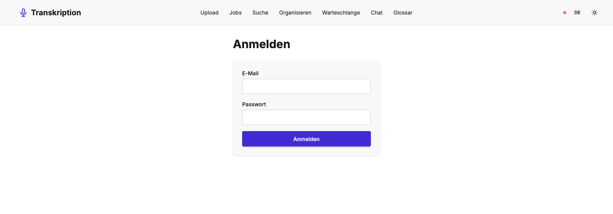
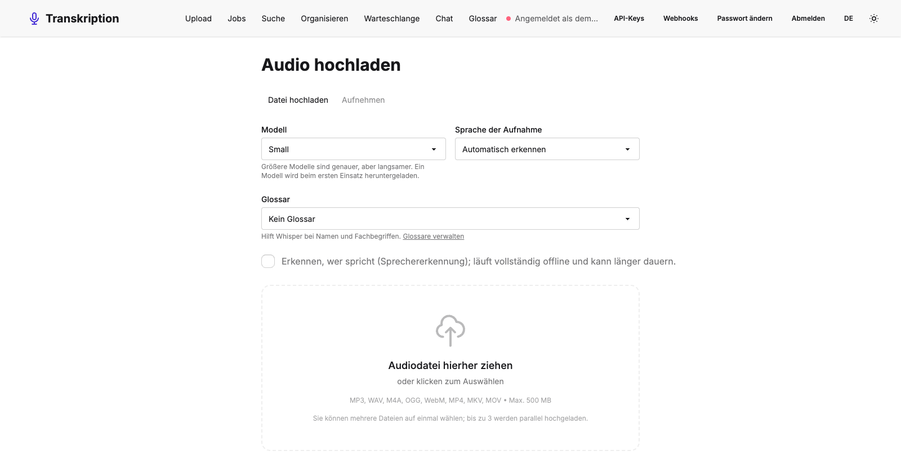
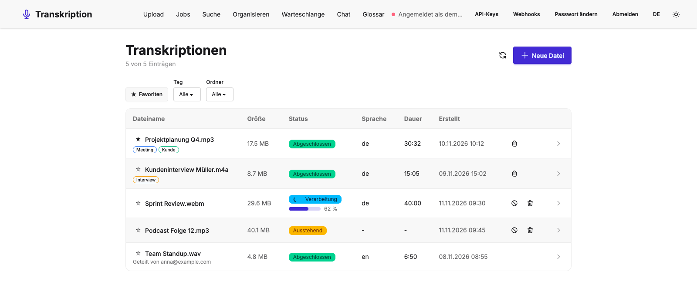
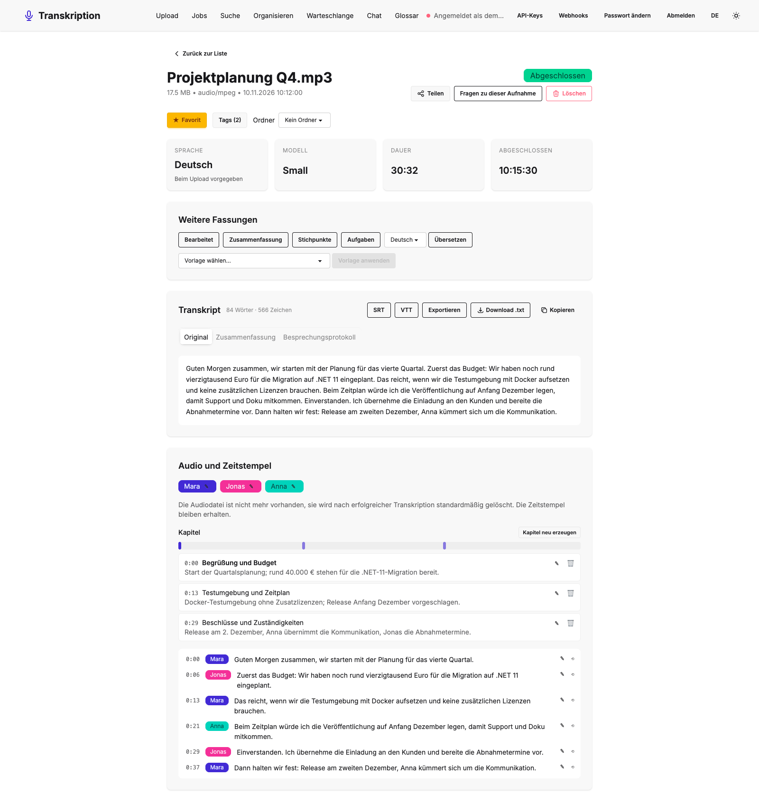
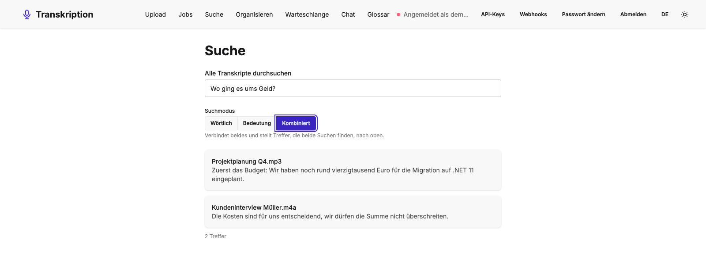

# 🎙️ Audio Transcription

[](https://github.com/MaikPeters1511/AudioTranscription/actions/workflows/ci.yml)

📝 [Changelog](CHANGELOG.md)

Lokale, private Audio-Transkription auf Basis von [Whisper.net](https://github.com/sandrohanea/whisper.net) (whisper.cpp) — läuft komplett offline, ohne dass Audiodaten an einen externen Dienst gesendet werden.

Lade eine Audiodatei hoch, verfolge den Verarbeitungsstatus live über SignalR und erhalte das fertige Transkript direkt im Browser — mit optionaler Nachbearbeitung durch ein lokales Ollama-LLM.

## ✨ Features

- 🔒 **Vollständig offline** — Transkription läuft lokal via Whisper.net, keine Cloud-APIs
- 📤 **Drag & Drop Upload** — MP3, WAV, M4A, OGG sowie Video (MP4, WebM, MKV, MOV — es wird nur die Tonspur verwendet), bis 500 MB (konfigurierbar), per Streaming direkt auf die Platte geschrieben
- 🎙️ **Direkt im Browser aufnehmen** — Mikrofonaufnahme ohne vorherigen Datei-Export, Vorhören vor dem Transkribieren (siehe unten, HTTPS erforderlich)
- ⚡ **Live-Updates** — Job-Status und Fortschritt in Prozent werden per SignalR in Echtzeit an das Frontend gepusht
- 📄 **Transkript-Verwaltung** — Kopieren, als `.txt` herunterladen, Wort-/Zeichenanzahl
- 🌗 **Hell/Dunkel-Theme**, responsives UI (Desktop-Tabelle + Mobile-Karten)
- 🎛️ **Modell und Sprache wählbar** — pro Upload ein freigegebenes Whisper-Modell und die Sprache der Aufnahme (oder automatische Erkennung)
- ⏱️ **Zeitstempel und Untertitel** — Export als `.srt`/`.vtt`, Audio-Player mit mitlaufendem Transkript (Klick auf einen Satz springt dorthin)
- 📄 **Weitere Exportformate** — Transkript und nachbearbeitete Fassungen als Word (DOCX), Markdown, JSON oder PDF, optional mit Zeitstempeln und Sprechernamen (Export-Menü in der Detailansicht)
- 📚 **Glossar für Fachbegriffe** — eigene Begriffslisten, die beim Upload wählbar sind und Whisper als Initial-Prompt für Namen und Fachwörter mitgegeben werden (zu lange Listen werden gemeldet statt still abgeschnitten)
- 📥 **Batch-Upload und Warteschlange** — mehrere Dateien auf einmal hochladen (bis zu 3 parallel, Fortschritt und Abbruch je Datei, ein Fehler stoppt die anderen nicht); die Warteschlange zeigt Position, geschätzte Wartezeit und erlaubt Priorität ändern und Abbrechen
- 🧠 **Nachbearbeitung mit Ollama** — aus jedem fertigen Transkript per Klick eine bereinigte Fassung, Zusammenfassung, Stichpunkte, Aufgabenliste oder Übersetzung erzeugen
- 🗣️ **Sprechererkennung (optional)** — „Wer spricht wann?“: Segmente werden Sprechern zugeordnet, die sich umbenennen lassen; Export (SRT/VTT) enthält die Sprechernamen; läuft vollständig offline (sherpa-onnx)
- 🏷️ **Tags, Ordner und Favoriten** — jeder Benutzer ordnet seine Jobs persönlich (auch geteilte), filtert die Liste und die Suche danach und verwaltet alles unter „Organisieren“
- 🔍 **Volltextsuche** — alle Transkripte (Rohtext, Segmente, Fassungen) durchsuchen, inkl. Stemming für gebeugte deutsche Wortformen; Treffer springen direkt an die passende Stelle im Player
- ✏️ **Transkript-Editor** — Segmente direkt im Player korrigieren (Enter/Doppelklick, Strg+Enter speichert, Alt+P spielt das Segment ab); jede Änderung ist eine neue Version mit Verlauf, Diff und „Wiederherstellen“, das Roh-Transkript bleibt unverändert; Suche, Untertitel und Exporte nutzen die korrigierte Fassung
- 🔁 **Wiederaufnehmbarer Upload** — Dateien ab 10 MiB werden in Chunks per tus-Protokoll hochgeladen: automatische Wiederholung bei Verbindungsabbruch, Pause/Fortsetzen, Abbruch räumt den Teil-Upload auf; kleinere Dateien und der bisherige Endpoint bleiben unverändert (siehe [ADR 0006](docs/adr/0006-resumable-upload-spike.md))
- 📑 **Automatische Kapitel** — das lokale Sprachmodell gliedert lange Aufnahmen in Abschnitte mit Überschrift und Kurzzusammenfassung (Map-Reduce über Fenster, Grenzen auf Segmentgrenzen); Marker auf der Zeitleiste und Kapitelliste im Player, Sprung per Klick oder Tastatur, Kapitel umbenennen und löschen
- 📝 **Protokoll-Vorlagen** — strukturierte Nachbearbeitung mit Vorlagen (eingebaut: Besprechungsprotokoll, Entscheidungsliste, Aufgaben mit Verantwortlichen; eigene Vorlagen durch Admins): das Ergebnis wird gegen ein JSON-Schema geprüft und als Markdown gerendert, Verantwortliche erscheinen nur für benannte Sprecher
- 🧠 **Semantische Suche** — Suche in natürlicher Sprache über Embeddings in Qdrant („Wann ging es ums Geld?“ findet die Budgetrunde): Modi Wörtlich, Bedeutung und Kombiniert (Reciprocal Rank Fusion mit der Volltextsuche); Modell lokal über Ollama (`bge-m3`), OpenAI nur per ausdrücklicher Konfiguration; Berechtigungen serverseitig erzwungen (siehe [ADR 0010](docs/adr/0010-semantische-suche-embeddings.md))
- 💬 **Chat mit Transkripten (RAG)** — Fragen an eine Aufnahme, einen Ordner oder alles stellen; die Antwort wird gestreamt und nennt überprüfbare Fundstellen mit Sprung in den Player. Standardmäßig lokal (Ollama); die Oberfläche zeigt immer, welches Modell antwortet und ob es ein externer Dienst ist. Transkripte gelten als untrusted Data, Zitate verweisen nur auf gelieferte Quellen (siehe [ADR 0011](docs/adr/0011-rag-chat-prompt-und-injection-schutz.md))
- 📱 **PWA und Offline-Aufnahme** — App auf dem Handy installierbar; Aufnahmen werden abschnittsweise auf dem Gerät gesichert (überstehen Absturz und geschlossenes Tab) und bei Verbindung automatisch hochgeladen; der Service Worker cacht nur die App-Shell, nie API-Antworten oder Transkripte (siehe [ADR 0012](docs/adr/0012-pwa-und-offline-aufnahme.md) und [Installation und Offline-Aufnahme](#installation-und-offline-aufnahme))
- 🤖 **Automatisierung** — API-Keys für Skripte (gehasht gespeichert, Scopes, Ablauf, jederzeit entziehbar), signierte Webhooks mit Wiederholung und Zustellungsprotokoll für n8n/Zapier und ein überwachter Ordner („Datei ablegen, Transkript erhalten“); SSRF-geschützt (siehe [ADR 0009](docs/adr/0009-automatisierung-api-keys-webhooks-ordner-watch.md) und [Automatisierung](#-automatisierung))
- 📈 **Observability** — fachliche Metriken (Jobs, Dauer, Echtzeitfaktor, Warteschlange), Traces der Pipeline und Readiness-Checks, optional mit Prometheus und Grafana; ohne Dateinamen oder Inhalte (siehe [docs/observability.md](docs/observability.md))
- 🐳 **.NET Aspire** orchestriert API, Datenbank, Web-Frontend (und optional Ollama) für lokale Entwicklung

## 🖼️ Screenshots

| Anmeldung | Upload |
|---|---|
|  |  |

| Job-Übersicht | Job-Details mit Sprechern und Fassungen |
|---|---|
|  |  |

| Volltextsuche |
|---|
|  |

## 🔐 Datenschutz

- Hochgeladene Dateien werden nur lokal im Ordner `temp-uploads/` der API gespeichert (`Upload:TempStoragePath`) und standardmäßig nach erfolgreicher Transkription gelöscht (`Upload:DeleteAfterTranscription`).
- Der Audio-Player in der Detailansicht braucht die hochgeladene Datei. Mit der Standardeinstellung ist sie nach erfolgreicher Transkription gelöscht, dann zeigt die Ansicht nur die Segmente mit Zeitstempeln. Wer den Player nutzen will, setzt `Upload:DeleteAfterTranscription=false` und nimmt in Kauf, dass die Audiodateien auf dem Server bleiben.
- **Aufbewahrungsfristen (optional):** Standardmäßig wird nichts automatisch gelöscht. Mit `Retention:TranscriptDays` (z. B. `90`) werden fertige, fehlgeschlagene und abgebrochene Jobs samt Transkript, Segmenten, Fassungen, Freigaben und Audiodatei so viele Tage nach Abschluss gelöscht. `Retention:AudioDays` löscht nur die Audiodatei, das Transkript bleibt. `Retention:RunIntervalHours` (Standard 6, erlaubt 1 bis 168) legt fest, wie oft geprüft wird, `Retention:MaxJobsPerRun` (Standard 500) begrenzt, wie viele Jobs ein Lauf höchstens löscht (älteste zuerst, der Rest folgt im nächsten Lauf). Erlaubt sind 0 bis 36500 Tage; ungültige Werte verhindern den Start mit einer Fehlermeldung. Offene Jobs und Jobs ohne Eigentümer (siehe Admin-Zuordnung) werden nie gelöscht. Der Eigentümer kann einen Job in der Detailansicht vor dem automatischen Löschen schützen. Das Löschprotokoll enthält nur die Job-ID, keine Dateinamen oder Inhalte. **Achtung beim ersten Einschalten:** Beim nächsten Start werden alle bereits abgelaufenen Jobs gelöscht (bis zur Grenze pro Lauf), und das ist nicht rückgängig zu machen. Das Log nennt vorher als Warnung, wie viele Jobs ein Lauf löschen wird. Wer einen Test möchte, startet zuerst mit einer großen Frist (z. B. 3650) und verkürzt sie schrittweise. Ein Eigentümer kann seine Jobs dauerhaft schützen; wer Löschfristen verbindlich durchsetzen muss, braucht dafür eine eigene Regel. Umgebungsvariablen: `Retention__TranscriptDays`, `Retention__AudioDays`, `Retention__RunIntervalHours`.
- `temp-uploads/`, Audiodateien und die Whisper-Modelle sind per `.gitignore` ausgeschlossen. Der Job `Repo hygiene` im CI-Workflow lässt jeden PR fehlschlagen, der solche Dateien enthält.

## 🔑 Anmeldung

Die App ist nur nach Login nutzbar. Sie verwendet lokale Konten (ASP.NET Core Identity, [ADR 0003](docs/adr/0003-authentifizierung.md)), jeder Benutzer sieht nur seine eigenen Jobs und die, die andere read-only mit ihm geteilt haben ([ADR 0007](docs/adr/0007-jobs-pro-benutzer.md)). Eine Selbst-Registrierung ist standardmäßig **aus**.

### Initialer Admin-Account

Der `InitialUserSeeder` (`AudioTranscription.Api/Auth/InitialUserSeeder.cs`) legt beim Start automatisch den ersten Benutzer an — aber **nur**, solange noch kein User existiert (idempotent, läuft also bei jedem weiteren Start folgenlos durch) und **nur**, wenn Zugangsdaten konfiguriert sind. Aus Sicherheitsgründen gibt es bewusst **kein hardcodiertes Standardpasswort**: Fehlen E-Mail oder Passwort, loggt der Seeder lediglich eine Warnung und legt kein Konto an. Der angelegte Account erhält automatisch die `Admin`-Rolle (`RoleManager<IdentityRole>`).

Die Zugangsdaten werden ausschließlich aus der Konfiguration gelesen (`Auth:InitialUser:Email` / `Auth:InitialUser:Password`), je nach Umgebung wie folgt gesetzt:

| Umgebung | So setzt du den ersten Benutzer |
|---|---|
| Aspire | `dotnet user-secrets set "Parameters:initial-user-email" "du@example.com" --project AudioTranscription.AppHost` und ebenso `Parameters:initial-user-password`. Fehlen die Werte, fragt das Aspire-Dashboard nach. Im AppHost (`AudioTranscription.AppHost/Program.cs`) werden diese Parameter — das Passwort als `secret: true` — an die API als `Auth__InitialUser__Email`/`Auth__InitialUser__Password` durchgereicht. |
| docker compose | `.env.example` nach `.env` kopieren (wird nicht committet) und `INITIAL_USER_EMAIL`/`INITIAL_USER_PASSWORD` setzen |
| API direkt / lokale Entwicklung | User-Secrets des API-Projekts setzen: <br>`dotnet user-secrets set "Auth:InitialUser:Email" "admin@example.com" --project AudioTranscription.Api` <br>`dotnet user-secrets set "Auth:InitialUser:Password" "<dein-passwort>" --project AudioTranscription.Api` |
| Produktion / Container (ohne Aspire) | Umgebungsvariablen `Auth__InitialUser__Email` und `Auth__InitialUser__Password` setzen (Doppel-Unterstrich als Trenner, ASP.NET-Core-Konvention für verschachtelte Konfigurationswerte) |

- **Passwortregeln:** Es gelten die Standardregeln von Identity (mindestens 6 Zeichen, Groß- und Kleinbuchstabe, Ziffer, Sonderzeichen). Erfüllt das Passwort sie nicht, wird kein Konto angelegt, und das Log nennt den Grund.
- **Weitere Konten:** Über `Auth:AllowRegistration=true` lässt sich `POST /api/auth/register` vorübergehend freischalten.
- **Session-Cookie:** Es ist `HttpOnly`, `Secure` und `SameSite=Strict`. Außerhalb von `localhost` muss die App deshalb über **HTTPS** erreichbar sein.
- **CORS:** Frontend und API laufen same-origin (Dev-Proxy bzw. nginx), CORS ist deshalb standardmäßig zu. Andere Origins lassen sich über `Cors:AllowedOrigins` freigeben.

### Passwörter, Sperre und Rate-Limits

- **Passwörter** brauchen mindestens **12 Zeichen** (gilt für den initialen Admin, neue Benutzer durch Admins und das Ändern des eigenen Passworts). Ein kürzeres `Auth:InitialUser:Password` wird abgelehnt, der Seeder protokolliert dann den Grund und legt kein Konto an.
- **Sperre:** Nach `Auth:Lockout:MaxFailedAttempts` (Standard 10) falschen Passwörtern in Folge ist das Konto `Auth:Lockout:DurationMinutes` (Standard 5) gesperrt; die Antwort verrät das nicht (immer `401`). Die Werte sind bewusst großzügig: Eine Sperre lässt sich auch absichtlich für fremde Konten, auch für das des einzigen Admins, auslösen.
- **Rate-Limits (`429`):** Anmeldeversuche höchstens `Auth:LoginAttemptsPerMinute` (Standard 60) pro Minute und Absenderadresse, das Freigeben von Aufnahmen (`POST /api/audio-jobs/{id}/shares`, prüft E-Mail-Adressen auf Existenz) höchstens `Auth:ShareRequestsPerMinute` (Standard 30) pro Minute und Benutzer. Hinter einem Reverse Proxy sieht die API nur dessen Adresse, alle Benutzer teilen sich dann das Anmelde-Limit; der Standard ist deshalb hoch angesetzt. Die Weitergabe der Client-Adresse (Forwarded Headers) ist nicht eingerichtet.

## 🏗️ Architektur

```
AudioTranscription.AppHost/          .NET Aspire orchestration (dev entrypoint)
AudioTranscription.Api/              ASP.NET Core Minimal API + SignalR Hub + Background Worker
AudioTranscription.Domain/           Entities, Enums (framework-unabhängig)
AudioTranscription.Infrastructure/   EF Core, Whisper.net-Integration, ffmpeg-Konvertierung
AudioTranscription.ServiceDefaults/  Gemeinsame Aspire-Service-Defaults (Telemetry, Health Checks)
Tests/AudioTranscription.Tests/      xUnit-Tests (Backend, siehe docs/adr/0001)
AudioTranscription.Web/              Angular 22 Frontend (Tailwind CSS + DaisyUI)
```

**Ablauf:** Datei-Upload → Validierung (Größe, MIME-Type, Magic Bytes) → Speicherung als Job (`Pending`) → Background Worker konvertiert Audio via `ffmpeg` zu 16 kHz-Mono-WAV → Whisper.net transkribiert → Ergebnis wird per SignalR an alle verbundenen Clients gepusht.

## 🔧 Voraussetzungen

| Tool | Version | Zweck |
|---|---|---|
| [.NET SDK](https://dotnet.microsoft.com/download) | 11.0+ | API & Aspire AppHost |
| [Node.js](https://nodejs.org/) | 20+ | Angular-Frontend |
| [Docker](https://www.docker.com/) | aktuell | SQL Server (& optional Ollama) via Aspire |
| [ffmpeg](https://ffmpeg.org/) | aktuell, im `PATH` | Audiokonvertierung (macOS: `brew install ffmpeg`, Linux: `apt install ffmpeg`) |

## 🚀 Schnellstart (lokale Entwicklung mit Aspire)

.NET Aspire startet SQL Server (als Container), die API und das Angular-Frontend mit einem einzigen Befehl:

```bash
cd AudioTranscription.AppHost
dotnet run
```

Das Aspire-Dashboard zeigt dir die zugewiesenen Ports für API und Web-Frontend an. Whisper.net lädt jedes Modell beim ersten Einsatz automatisch herunter (siehe [Whisper-Modelle](#-whisper-modelle)).

### Optional: Ollama-Nachbearbeitung aktivieren

In `AudioTranscription.Api/appsettings.json`:

```json
"Features": { "OllamaPostProcessing": true }
```

Beim nächsten `dotnet run` startet Aspire zusätzlich einen Ollama-Container inkl. `llama3.2`-Modell.

In der Detailansicht eines abgeschlossenen Jobs erscheint dann eine Aktionsleiste „Weitere Fassungen“ mit einem Knopf je Modus (Bereinigen, Zusammenfassen, Stichpunkte, Aufgaben, Übersetzen). Ergebnisse erscheinen als zusätzliche Tabs neben „Original“; ein erneuter Klick auf denselben Modus ersetzt das Ergebnis. Lange Transkripte werden für Zusammenfassung und Aufgaben in Abschnitten verarbeitet und anschließend zusammengeführt (`PostProcessing:MaxChunkLength` in `appsettings.json`, Richtwert in Zeichen statt Tokens, da für das gewählte Ollama-Modell kein Tokenizer verfügbar ist).

### Optional: Sprechererkennung (Diarisierung) aktivieren

Sprechererkennung läuft vollständig offline über [sherpa-onnx](https://github.com/k2-fsa/sherpa-onnx) und benötigt zwei ONNX-Modelle (pyannote-Segmentierung + Speaker-Embedding), die **nicht** mitgeliefert werden und selbst besorgt werden müssen (siehe [ADR 0004](docs/adr/0004-sprechererkennung.md)). In `AudioTranscription.Api/appsettings.json`:

```json
"Diarization": {
  "Enabled": true,
  "SegmentationModelPath": "/pfad/zu/segmentation.onnx",
  "EmbeddingModelPath": "/pfad/zu/embedding.onnx",
  "Threshold": 0.5,
  "NumThreads": 1
}
```

Beim Upload erscheint dann eine Checkbox „Sprechererkennung“. Ist sie aktiv, wird jedes Transkript-Segment nach der Transkription einem Sprecher zugeordnet (`Sprecher 1`, `Sprecher 2`, …); in der Detailansicht lassen sich Sprecher per Klick auf den Bearbeiten-Knopf umbenennen (z. B. „Anna“), SRT-/VTT-Export und die Segmentliste übernehmen den neuen Namen automatisch.

### Direkt im Browser aufnehmen

Die Upload-Seite hat zwei Reiter: „Datei hochladen“ und „Aufnehmen“. Im Aufnahme-Reiter starten/stoppen ein Knopf die Mikrofonaufnahme (`MediaRecorder`-API), danach lässt sich die Aufnahme vorhören und entweder transkribieren (wie ein normaler Upload) oder verwerfen. Das gewählte Modell/Sprache/Sprechererkennung (siehe oben) gilt auch für Aufnahmen.

**Wichtig:** `getUserMedia` (Mikrofonzugriff) verlangt einen [secure context](https://developer.mozilla.org/en-US/docs/Web/Security/Secure_Contexts) — die Seite muss über **HTTPS** oder `http://localhost` aufgerufen werden, sonst bietet der Browser den Reiter zwar an, aber die Berechtigungsanfrage schlägt fehl. In der Produktion (docker-compose/nginx) ist daher ein gültiges TLS-Zertifikat nötig, genau wie schon für das Session-Cookie (siehe [Anmeldung](#-anmeldung)).

Chrome und Firefox liefern die Aufnahme als `audio/webm;codecs=opus`, Safari als `audio/mp4` — beide werden vom Upload-Endpunkt akzeptiert. Manuell getestet wurde der volle Ablauf (Aufnehmen → Stoppen → Vorhören → Transkribieren) in Chromium; ein Test in echtem Firefox/Safari war in dieser Sandbox mangels installierter Browser nicht möglich (siehe Umsetzungsnotizen in der Story-Spezifikation).

### Installation und Offline-Aufnahme

**Installieren:** Im Browser (Chrome/Edge/Android: Installationshinweis auf der Upload-Seite oder Browser-Menü „App installieren“; iOS Safari: Teilen → „Zum Home-Bildschirm“) lässt sich die App wie eine normale App starten. Voraussetzung ist **HTTPS** (oder `http://localhost`): Service Worker und Mikrofonzugriff funktionieren nur in einem [secure context](https://developer.mozilla.org/en-US/docs/Web/Security/Secure_Contexts). Der Service Worker ist nur im Produktions-Build aktiv (`ng build`, docker-compose); `ng serve` startet ohne ihn, damit Änderungen sofort sichtbar sind. Prüfen lässt sich die Installierbarkeit in Chrome unter DevTools → Application → Manifest.

**Was der Service Worker cacht:** ausschließlich die App-Shell (`index.html`, JS/CSS, Icons, Manifest, Übersetzungsdateien). Es gibt bewusst keine `dataGroups`: API-Antworten, Transkripte, Audio und SignalR laufen immer direkt ans Netz und werden nicht gecacht (`ngsw-config.json`, abgesichert durch einen Test). Ohne Verbindung öffnet sich daher die Oberfläche, aber Jobs und Transkripte sind nicht lesbar.

**Offline aufnehmen:** Beim Aufnehmen wird jeder Abschnitt (5 s) sofort in IndexedDB gesichert. Ist das Gerät offline, bietet die Aufnahme „Für späteren Upload speichern“ an; die Liste „Wartet auf Upload“ (Upload-Seite) zeigt Status und Fortschritt, erlaubt Erneut versuchen und Löschen. Sobald wieder eine Verbindung besteht, werden die Aufnahmen nacheinander hochgeladen (ab 10 MiB über den wiederaufnehmbaren Upload) und danach lokal gelöscht. Nach Absturz oder geschlossenem Tab erscheint die Aufnahme beim nächsten Start in der Liste.

**Datenschutz:** Nicht hochgeladene Aufnahmen liegen unverschlüsselt im Speicher des Browsers auf diesem Gerät. Beim Abmelden fragt die App nach, wenn noch welche vorhanden sind, und löscht sie bei Bestätigung. Ist der Gerätespeicher voll, beendet die Aufnahme kontrolliert und meldet das, das bisher Aufgenommene bleibt erhalten. Ein Neustart ohne Verbindung öffnet die Oberfläche nur für den zuletzt angemeldeten Benutzer (nur die E-Mail-Adresse wird gemerkt); die API prüft weiterhin jede Anfrage.

### Volltextsuche

Die Suchseite (Reiter „Suche“) durchsucht Rohtranskripte, Segmente und erzeugte Fassungen (S10) per SQL Server Full-Text Search ([ADR 0005](docs/adr/0005-volltextsuche.md)) und springt bei einem Segment-Treffer direkt an die passende Stelle im Player.

**Wichtig:** Das Standard-Image `mcr.microsoft.com/mssql/server` bringt Full-Text Search **nicht** mit — es ist ein separates Paket. Aspire und `docker-compose.yml` bauen deshalb ein eigenes Image aus [`docker/mssql-fts/Dockerfile`](docker/mssql-fts/Dockerfile), das dieses Paket nachinstalliert; das Bauen braucht (einmalig) Internetzugriff auf `packages.microsoft.com`. Ohne dieses Image legt die Migration den Suchindex nicht an (sie schlägt nicht fehl, ist aber ein No-Op) und `GET /api/search` liefert einen Serverfehler.

## 🐳 Alternative: docker-compose

Für einen produktionsnäheren Stack ohne Aspire:

```bash
docker compose up --build
```

Startet SQL Server, API (Port `8080`) und das gebaute Angular-Frontend (Port `80`).

## 🖥️ Frontend separat starten

```bash
cd AudioTranscription.Web
npm install
npm start
```

Läuft standardmäßig auf `http://localhost:4200` und erwartet die API über einen Dev-Proxy unter `/api`.

## 🧪 Tests

```bash
# Backend (xUnit). Die Datenbank-Tests starten SQL Server per Testcontainers, Docker muss laufen.
dotnet test

# Frontend-Unit-Tests (Vitest über den Angular-Builder, Node 22.22.3+ oder 24)
cd AudioTranscription.Web
npm test -- --watch=false
```

Ablage der Tests: siehe [ADR 0001](docs/adr/0001-ablageort-von-tests.md).

## 📁 Konfiguration

Wichtige Einstellungen in `AudioTranscription.Api/appsettings.json`:

```json
{
  "Upload": {
    "MaxFileSizeBytes": 500000000,
    "AllowedContentTypes": [
      "audio/mpeg", "audio/wav", "audio/x-wav", "audio/mp4", "audio/x-m4a", "audio/ogg", "audio/webm",
      "video/mp4", "video/webm", "video/x-matroska", "video/quicktime"
    ],
    "TempStoragePath": "temp-uploads",
    "DeleteAfterTranscription": true,
    "OrphanedFileRetentionHours": 24
  },
  "Whisper": {
    "DefaultModel": "Base",
    "AllowedModels": ["Tiny", "Base", "Small", "Medium", "LargeV3"],
    "SupportedLanguages": ["de", "en", "fr", "..."],
    "ModelsDirectory": "whisper-models"
  },
  "Auth": { "AllowRegistration": false },
  "Cors": { "AllowedOrigins": [] },
  "PostProcessing": { "MaxChunkLength": 6000 },
  "Features": { "OllamaPostProcessing": false },
  "Diarization": {
    "Enabled": false,
    "SegmentationModelPath": "",
    "EmbeddingModelPath": "",
    "Threshold": 0.5,
    "NumThreads": 1
  }
}
```

`Upload:MaxFileSizeBytes` bestimmt außer der serverseitigen Prüfung auch die Kestrel- (`MaxRequestBodySize`) und Formular-Limits (`FormOptions.MultipartBodyLengthLimit`, siehe `Program.cs`) — es genügt, hier einen Wert zu ändern. Videos (MP4/WebM/MKV/MOV) werden akzeptiert, aber nur ihre Tonspur wird transkribiert (ffmpeg `-vn`). Beim docker-compose-Setup wird derselbe Wert zusätzlich für nginx' `client_max_body_size` gebraucht (sonst würde nginx große Uploads schon vor der API abweisen); dort steuert die Umgebungsvariable `UPLOAD_MAX_FILE_SIZE_MB` (Default 500) beide Seiten gemeinsam.

## 🤖 Automatisierung

Drei Wege, die Anwendung ohne Browser zu nutzen. Die Entscheidungen dahinter stehen in [ADR 0009](docs/adr/0009-automatisierung-api-keys-webhooks-ordner-watch.md).

### API-Keys für Skripte

Unter **API-Keys** in der Anwendung legst du einen Key an (Name, Berechtigungen, Ablauf: 30/90/365 Tage oder nie). Der Key wird **nur einmal** angezeigt und danach nur als Hash gespeichert; verlierst du ihn, entziehst du ihn und legst einen neuen an.

| Berechtigung | erlaubt |
|---|---|
| `jobs:read` | Aufträge, Transkripte, Untertitel, Exporte und die Suche lesen (`GET`) |
| `jobs:write` | Aufträge hochladen, ändern, abbrechen und löschen (`POST`/`PUT`/`DELETE`, tus-Uploads) |

Ein Key sieht genau die Aufträge seines Besitzers und erreicht nur `/api/audio-jobs`, `/api/uploads` und `/api/search`. Key-, Webhook-, Admin- und Konto-Verwaltung bleiben der Browser-Sitzung vorbehalten (`403` für Keys). Ungültige, abgelaufene oder entzogene Keys sowie Keys deaktivierter Benutzer antworten mit `401`, fehlende Berechtigung mit `403`, zu viele Anfragen (Standard 300 pro Minute und Key, `ApiKeys:RequestsPerMinute`) mit `429`.

```bash
# Aufträge auflisten (Bearer oder Header X-Api-Key)
curl -H "Authorization: Bearer at_AbCdEfGh_…" https://transkription.example.com/api/audio-jobs

# Datei hochladen (jobs:write); language ist optional
curl -H "X-Api-Key: at_AbCdEfGh_…" \
     -F "file=@besprechung.mp3" -F "language=de" \
     https://transkription.example.com/api/audio-jobs

# Transkript als Markdown holen (jobs:read)
curl -H "Authorization: Bearer at_AbCdEfGh_…" -o protokoll.md \
     "https://transkription.example.com/api/audio-jobs/<id>/export?format=md"
```

Den Key nie in URLs, Skripte im Repository oder Logs schreiben; als Umgebungsvariable oder Secret des Werkzeugs ablegen.

### Webhooks (n8n, Zapier, …)

Unter **Webhooks** hinterlegst du eine **öffentliche https-Adresse** und wählst die Ereignisse `job.completed` (Transkript fertig) und `job.failed`. Das Signaturgeheimnis (`whsec_…`) wird einmal angezeigt. Mit **Testen** sendest du sofort ein signiertes `webhook.test`; der Verlauf zeigt Status, Versuche und den HTTP-Status jeder Zustellung.

Jeder Aufruf ist ein `POST` mit JSON ohne Transkript und ohne Fehlertexte (Datenschutz); den Inhalt holt der Empfänger bei Bedarf mit einem API-Key:

```json
{
  "event": "job.completed",
  "deliveryId": "6f1c2a52-…",
  "createdAt": "2026-11-10T12:00:00Z",
  "data": { "jobId": "…", "fileName": "besprechung.mp3", "status": "Completed",
            "language": "de", "durationSeconds": 1832.4, "completedAt": "2026-11-10T11:59:58Z" }
}
```

| Header | Inhalt |
|---|---|
| `X-Webhook-Id` | ID der Zustellung, bei allen Wiederholungen gleich (Duplikate erkennen) |
| `X-Webhook-Event` | Ereignisname |
| `X-Webhook-Timestamp` | Unix-Sekunden |
| `X-Webhook-Signature` | `v1=` + Hex-HMAC-SHA256 über `"<Timestamp>.<Body>"` mit dem Geheimnis |

**Signatur prüfen** (Node.js; den rohen Body verwenden, nicht den geparsten):

```js
import { createHmac, timingSafeEqual } from 'node:crypto';

function isValid(secret, headers, rawBody) {
  const timestamp = headers['x-webhook-timestamp'];
  if (Math.abs(Date.now() / 1000 - Number(timestamp)) > 300) return false; // Replay-Schutz
  const expected = 'v1=' + createHmac('sha256', secret).update(`${timestamp}.${rawBody}`).digest('hex');
  const given = headers['x-webhook-signature'] ?? '';
  return given.length === expected.length && timingSafeEqual(Buffer.from(given), Buffer.from(expected));
}
```

Python: `hmac.new(secret.encode(), f"{timestamp}.{body}".encode(), hashlib.sha256).hexdigest()` und mit `hmac.compare_digest` gegen den Header ohne `v1=` vergleichen.

**n8n:** Einen *Webhook*-Trigger (Methode `POST`, „Raw Body“ aktivieren) anlegen, dessen **Production URL** hier eintragen und mit einem *Crypto*-Knoten (HMAC, SHA256, Hex) oder einem *Code*-Knoten die Signatur wie oben prüfen. Danach holt ein *HTTP Request*-Knoten mit dem API-Key (`Authorization: Bearer …`) den Export unter `/api/audio-jobs/{jobId}/export?format=md`. **Zapier:** *Webhooks by Zapier → Catch Hook* genauso; die Signaturprüfung geht dort im *Code*-Schritt.

**Zustellung und Wiederholung:** Jede 2xx-Antwort gilt als Erfolg. Bei Timeout (10 s), Verbindungsfehler, `5xx`, `408`, `429` und Weiterleitungen folgt ein neuer Versuch nach **30 s, 2 min, 10 min, 1 h und 6 h** (6 Versuche insgesamt, danach „Fehlgeschlagen“); andere `4xx` werden nicht wiederholt. Die Zustellungen liegen in der Datenbank und überstehen Neustarts; mindestens einmal heißt auch, dass ein Empfänger gelegentlich dieselbe `X-Webhook-Id` zweimal sieht. Zustellungen werden nach 30 Tagen gelöscht.

**SSRF-Schutz:** Nur `https` (ohne Zugangsdaten in der URL), keine Ziele in Loopback-, privaten, Link-Local- (Cloud-Metadaten `169.254.169.254`) oder CGNAT-Netzen, auch nicht über einen DNS-Namen, der dorthin zeigt (die Adresse wird beim Verbinden geprüft), und **keine Weiterleitungen**. Liegt dein n8n im selben Docker-Netz, erlaubt der Betreiber das ausdrücklich mit `Webhooks:AllowPrivateTargets=true` (docker-compose: `WEBHOOKS_ALLOW_PRIVATE_TARGETS=true`); `Webhooks:AllowHttp=true` erlaubt zusätzlich unverschlüsseltes `http`.

**Wichtig für den Betrieb:** Die Geheimnisse sind mit ASP.NET Core Data Protection verschlüsselt. Die Schlüssel müssen einen Neustart überleben (`DataProtection:KeysPath` auf einen persistenten Ordner; docker-compose macht das mit dem Volume `api-dataprotection`), sonst sind Geheimnisse und Anmeldesitzungen danach ungültig.

### Ordner-Watch („Datei ablegen, Transkript erhalten“)

Der Betreiber (nicht die Benutzer) legt in der Konfiguration überwachte Ordner fest; jede abgelegte Datei wird ein Auftrag des Zielbenutzers:

```json
"Watch": {
  "PollIntervalSeconds": 10,
  "StableSeconds": 5,
  "Folders": [
    { "Path": "/data/inbox", "User": "anna@example.com", "Model": "Base", "Language": "de" }
  ]
}
```

(Als Umgebungsvariablen: `Watch__Folders__0__Path`, `Watch__Folders__0__User`, …; `Model` und `Language` sind optional.)

- Gelesen werden nur Dateien **direkt im Ordner**, keine Unterordner, keine versteckten Dateien (Punkt am Anfang) und **keine Symlinks**. Erlaubt sind `mp3 wav m4a ogg webm mp4 mkv mov`; der Inhalt wird wie beim Upload an den Magic Bytes geprüft, das Größenlimit ist `Upload:MaxFileSizeBytes`.
- Eine Datei wird erst übernommen, wenn sie `StableSeconds` unverändert ist (halb kopierte Dateien werden nicht gelesen).
- Nach dem Anlegen des Auftrags wird das Original nach `processed/` **verschoben**, abgelehnte Dateien (falscher Typ, zu groß, kein Audio) nach `rejected/`. Beides sind Unterordner des überwachten Ordners.
- **Neustart-sicher:** Die Auftrags-ID wird aus Ordner, Dateiname, Größe und Änderungszeit abgeleitet. Bricht der Dienst zwischen Anlegen und Verschieben ab, erkennt der nächste Durchlauf den vorhandenen Auftrag und verschiebt die Datei nur noch.
- Gibt es den Zielbenutzer nicht oder ist er deaktiviert, bleibt der Ordner unberührt (Warnung im Log). Pro Ordner genau ein Benutzer; Ordner dürfen sich nicht überlappen. Der Dienst gehört nur auf **eine** API-Instanz.

## 🎛️ Whisper-Modelle

Beim Upload wählt man ein Modell aus `Whisper:AllowedModels` (Standard: `Whisper:DefaultModel`) und die Sprache der Aufnahme aus `Whisper:SupportedLanguages` oder „Automatisch erkennen“. Eine vorgegebene Sprache verbessert die Erkennung, vor allem bei kurzen oder nicht-englischen Aufnahmen.

| Modell | Download | RAM (ca.) | Hinweis |
|---|---|---|---|
| `Tiny` | 75 MB | 0,3 GB | sehr schnell, ungenau |
| `Base` | 142 MB | 0,4 GB | Standard |
| `Small` | 466 MB | 0,9 GB | deutlich besser bei Deutsch |
| `Medium` | 1,5 GB | 2,1 GB | langsam ohne GPU |
| `LargeV3` | 2,9 GB | 3,9 GB | am genauesten, sehr langsam ohne GPU |

- Die Werte stammen aus der whisper.cpp-Dokumentation und sind Richtwerte.
- **Download:** Ein Modell wird beim ersten Job mit diesem Modell nach `Whisper:ModelsDirectory` geladen. Relative Pfade gelten ab dem Programmverzeichnis. Dieser Job dauert entsprechend länger.
- **Speicher:** Jedes einmal genutzte Modell bleibt bis zum Neustart geladen. Gibst du nur Modelle frei, die gemeinsam in den Arbeitsspeicher passen, kommt es nicht zu Engpässen.
- **Namen:** Erlaubt sind alle Namen von Whisper.nets `GgmlType`, z. B. `SmallEn` oder `LargeV3Turbo`.
- **Prüfung beim Start:** Eine ungültige Konfiguration verhindert den Start der API und nennt den Grund, z. B. ein unbekanntes Modell oder ein `DefaultModel`, das nicht in `AllowedModels` steht.

## 🚀 GPU-Beschleunigung

Whisper.net kann Modelle über CUDA (NVIDIA) oder CoreML (Apple Silicon) statt auf der CPU laufen lassen — besonders bei `Medium`/`LargeV3` ein deutlicher Geschwindigkeitsgewinn. Ohne passende GPU/Treiber fällt die App automatisch auf die CPU zurück; das ist keine Sonderbehandlung, sondern Whisper.nets eigene Standard-Ladereihenfolge (`Cuda → Cuda12 → Vulkan → CoreML → OpenVino → Cpu → CpuNoAvx`), die zuletzt immer die CPU versucht.

**Reihenfolge konfigurieren** (`Whisper:RuntimeOrder`, z. B. `["Cuda12", "Cuda", "Cpu"]`): schränkt ein, welche Runtimes in welcher Reihenfolge versucht werden, statt der eingebauten Liste. Wird beim Start geloggt (`Whisper native runtime order: [...]`); welche Runtime tatsächlich lädt, erscheint erst beim ersten genutzten Modell im Log (`Whisper native runtime in use: ...`), weil Modelle je Job lazy geladen werden.

**NVIDIA/CUDA (Docker):**
- Voraussetzungen auf dem Host: ein aktueller NVIDIA-Treiber und das [NVIDIA Container Toolkit](https://docs.nvidia.com/datacenter/cloud-native/container-toolkit/latest/install-guide.html) (stellt Docker den `nvidia`-Device-Treiber bereit).
- Das `-cuda`-Image (`docker build --target final-cuda ...`) basiert auf `nvidia/cuda:12.4.1-runtime-ubuntu22.04` statt dem normalen .NET-Runtime-Image, damit die von Whisper.net.Runtime.Cuda genutzten CUDA-Bibliotheken (`libcudart`, `libcublas`) vorhanden sind. Das Standard-Image bleibt CPU-only und dadurch klein — die CUDA-Pakete werden nur für dieses Ziel gebaut (`IncludeCudaRuntime=true`).
- Start: `docker compose --profile gpu up api-gpu` (läuft neben dem normalen `api`-Dienst auf Port 8081, statt ihn zu ersetzen). `nvidia-smi` im Container (`docker compose exec api-gpu nvidia-smi`) zeigt die GPU-Auslastung während einer Transkription.
- Welche CUDA-Version zum Treiber passt, hängt von der Whisper.net.Runtime.Cuda-Version ab; im Zweifel die vom NVIDIA Container Toolkit installierte CUDA-Version prüfen.

**Apple Silicon/CoreML:** Läuft nativ (kein Docker) auf macOS mit Apple Silicon; die CoreML-Runtime ist bereits Teil des Standard-Pakets. Erfordert eine unterstützte macOS-Version für Whisper.net.Runtime.CoreML (siehe dessen Release-Hinweise) — auf Linux/Windows wird diese Runtime automatisch übersprungen.

**Bekannte Einschränkung:** In dieser Entwicklungsumgebung ohne GPU-Hardware und ohne laufenden Docker-Daemon konnte weder ein echter CPU-vs-GPU-Benchmark noch der `-cuda`-Image-Build durchgeführt werden (siehe Story S15 in `UserStories/`); der CPU-Fallback selbst wurde aber per Test verifiziert (`WhisperRuntimeConfiguratorTests`).

## 📡 API-Übersicht

Alle Endpunkte außer Login erfordern eine Anmeldung, sonst antworten sie mit `401`. Skripte können sich statt mit der Browser-Sitzung mit einem [API-Key](#api-keys-für-skripte) anmelden (`Authorization: Bearer at_…` oder Header `X-Api-Key`); `GET /openapi/v1.json` beschreibt beide Schemata (`SessionCookie`, `ApiKey`, `BearerApiKey`).

**OpenAPI-Spezifikation:** `GET /openapi/v1.json` liefert die vollständige, maschinenlesbare Beschreibung aller Endpunkte (ASP.NET Cores eingebaute `AddOpenApi`/`MapOpenApi`-Unterstützung), ebenfalls hinter der Standard-Auth-Policy.

| Methode | Endpunkt | Beschreibung |
|---|---|---|
| `POST` | `/api/auth/login?useCookies=true` | Anmelden (`{ email, password }`), setzt das Session-Cookie |
| `POST` | `/api/auth/logout` | Abmelden |
| `GET` | `/api/auth/me` | Angemeldeter Benutzer (`{ email }`) |
| `POST` | `/api/audio-jobs` | Audiodatei hochladen (`file`, optional `model`, `language` und `diarize`), Transkriptions-Job anlegen. Unbekanntes Modell/Sprache oder `diarize=true` ohne konfigurierte Diarisierung: `400` |
| `POST`/`HEAD`/`PATCH`/`DELETE` | `/api/uploads[/{id}]` | Wiederaufnehmbarer Upload nach dem [tus-Protokoll](https://tus.io) (v1.0.0, Erweiterungen `creation`, `termination`): `POST` legt eine Sitzung an (`Upload-Length`, `Upload-Metadata` mit `filename`, `filetype` und optional `model`, `language`, `diarize`, `glossaryId`; zu große Datei `413`, falscher Typ `415`, ungültige Einstellungen `400`), `HEAD` liefert den Offset, `PATCH` hängt einen Chunk an (falscher Offset `409`). Die Sitzung gehört dem Benutzer, fremde Sitzungen sind `404`. Unvollständige Sitzungen werden nach `Upload:IncompleteSessionRetentionHours` (24) entfernt |
| `GET` | `/api/uploads/{id}/job` | Job einer fertigen Sitzung (`200 { id }`), `409` solange Bytes fehlen, `422` wenn die zusammengesetzte Datei nicht zum Content-Type passt |
| `GET` | `/api/transcription-options` | Wählbare Modelle, Standardmodell, Sprachen (`auto` ist immer möglich), `postProcessingEnabled`, `diarizationEnabled` |
| `GET` | `/api/audio-jobs` | Paginierte Liste aller Jobs |
| `GET` | `/api/audio-jobs/{id}` | Details & Transkript eines Jobs |
| `DELETE` | `/api/audio-jobs/{id}` | Job samt Transkript und Upload löschen (bricht einen laufenden Job vorher ab) |
| `POST` | `/api/audio-jobs/{id}/cancel` | Wartenden oder laufenden Job abbrechen |
| `POST` | `/api/audio-jobs/{id}/retry` | Fehlgeschlagenen oder abgebrochenen Job erneut einreihen |
| `GET` | `/api/audio-jobs/{id}/segments` | Zeitstempel-Segmente des Roh-Transkripts, bei Diarisierung inkl. `speakerIndex`/`speakerName` (`409`, solange der Job nicht abgeschlossen ist) |
| `POST` | `/api/audio-jobs/{id}/chapters` | Kapitelerzeugung im Hintergrund starten (ersetzt vorhandene Kapitel). `409`: Job nicht abgeschlossen oder ohne Segmente, `503`: kein Sprachmodell konfiguriert; nur für den Eigentümer |
| `GET` | `/api/audio-jobs/{id}/chapters` | Kapitel in Reihenfolge und Zustand der Erzeugung (`None`, `Pending`, `Completed`, `Failed`) |
| `PUT`/`DELETE` | `/api/audio-jobs/{id}/chapters/{chapterId}` | Titel/Zusammenfassung ändern bzw. Kapitel löschen (das Nachbarkapitel übernimmt den Zeitbereich); nur für den Eigentümer |
| `PUT` | `/api/audio-jobs/{id}/segments/{index}` | Segment korrigieren: Body `{ text, expectedVersion }`; legt eine neue Version an (`409`, wenn `expectedVersion` nicht die aktuelle ist oder der Job nicht abgeschlossen ist; nur für den Eigentümer) |
| `GET` | `/api/audio-jobs/{id}/segments/{index}/history` | Alle Versionen des Segments, neueste zuerst; Version 0 ist das Original |
| `POST` | `/api/audio-jobs/{id}/segments/{index}/restore` | Body `{ version, expectedVersion }`; stellt eine frühere Version als neue Version wieder her (nur für den Eigentümer) |
| `GET` | `/api/audio-jobs/{id}/subtitles?format=srt\|vtt` | Untertitel-Download, Cues bei Diarisierung mit Sprechername (`409` wie oben, `400` bei unbekanntem Format) |
| `GET` | `/api/audio-jobs/{id}/export?format=docx\|md\|json\|pdf&variant=&timestamps=&speakers=` | Export als Word, Markdown, JSON (`schemaVersion`) oder PDF, wahlweise für eine nachbearbeitete Fassung (`variant`=Variant-Id); `400` bei unbekanntem Format, `409` wenn Job/Variante nicht fertig, `404` bei fremder Variante |
| `GET` `POST` | `/api/glossaries` | Eigene Glossare (Name + Begriffe) auflisten / anlegen; `400` bei Duplikaten, zu langen Begriffen oder wenn die Begriffe Whispers Prompt-Fenster (≈224 Tokens) sprengen, `409` bei doppeltem Namen |
| `PUT` `DELETE` | `/api/glossaries/{id}` | Glossar ersetzen / löschen (`404` für fremde Glossare); bestehende Jobs behalten ihren gespeicherten Prompt |
| `GET` | `/api/queue` | Eigene laufende (Position 0) und wartende Jobs mit Position, Priorität und geschätzter Wartezeit; die Positionen zählen die Jobs aller Benutzer, gelistet werden nur eigene. Die Schätzung nutzt die Verarbeitungsgeschwindigkeit der letzten fertigen Jobs (Dateigröße als Näherung für die Audiolänge) und ist `null`, solange noch kein Job fertig ist |
| `PUT` | `/api/audio-jobs/{id}/priority` | Priorität eines wartenden Jobs setzen (`{"priority": -100..100}`, höher läuft zuerst, bei Gleichstand gilt die Upload-Reihenfolge); `400` außerhalb des Bereichs, `409` wenn der Job nicht mehr wartet, `404` für fremde Jobs |
| `GET` | `/api/audio-jobs/{id}/speakers` | Erkannte Sprecher eines Jobs mit aufgelöstem Namen (`Sprecher N` bis umbenannt) |
| `PUT` | `/api/audio-jobs/{id}/speakers/{index}` | Sprecher umbenennen (`{ displayName }`, max. 100 Zeichen); `404` bei unbekanntem Job/Sprecher |
| `GET` | `/api/audio-jobs/{id}/audio` | Hochgeladene Audiodatei mit HTTP-Range-Support; `410`, wenn sie schon gelöscht ist |
| `POST` | `/api/audio-jobs/{id}/variants` | Fassung erzeugen/neu erzeugen (`{ mode, targetLanguage? }`); `409` außer bei `Completed`, `503` ohne konfiguriertes Ollama |
| `GET` | `/api/templates` | Nachbearbeitungs-Vorlagen (eingebaute zuerst); eine Vorlage anwenden: `POST /api/audio-jobs/{id}/variants` mit `mode` `5` (Template) und `templateId` |
| `POST`/`PUT`/`DELETE` | `/api/templates[/{id}]` | Eigene Vorlagen verwalten (nur Admin): Body `{ name, description, prompt, outputSchema }`; Prompt bis 4000 Zeichen mit den Platzhaltern `{{SPEAKERS}}`/`{{LANGUAGE}}`, `outputSchema` als JSON-Schema (Typen object, array, string, integer, number, boolean). Ungültig: `400`, eingebaute Vorlagen ändern oder löschen: `409` |
| `GET` | `/api/audio-jobs/{id}/variants` | Erzeugte Fassungen eines Jobs |
| `GET` | `/api/search?q=&page=&pageSize=` | Volltextsuche über Rohtranskripte, Segmente und Fassungen; Treffer mit Snippet, Hervorhebungs-Offsets und optional `segmentStartMs`; `400` ohne `q` |
| `GET` | `/api/search/semantic?q=&mode=&page=&pageSize=` | Suche nach Bedeutung (`mode=semantic`, Standard) oder kombiniert mit der Volltextsuche (`mode=hybrid`); nur eigene und freigegebene Jobs, Treffer mit Sprungmarke. `503`: nicht konfiguriert, `409`: Index stammt von einem anderen Embedding-Modell und muss neu aufgebaut werden |
| `GET` | `/api/search/modes` | Ob die semantische und kombinierte Suche nutzbar sind (`{ semantic, indexStatus }`) |
| `POST` | `/api/chat` | Frage stellen, Antwort als Server-Sent Events (`meta`, `delta`, `done` mit Zitaten, `error`); Body `{ question, scope: { kind: all\|job\|folder, id }, conversationId }`. Höchstens `Chat:RequestsPerMinute` (20) Fragen pro Benutzer und Minute (`429`), `404` für fremde Aufnahmen/Ordner/Gespräche, `503` ohne Chat |
| `GET` | `/api/chat`, `/api/chat/{id}`, `DELETE /api/chat/{id}` | Eigene Gespräche (privat; fremde sind `404`) |
| `GET` | `/api/chat/info` | Ob der Chat verfügbar ist und welcher Anbieter und welches Modell antworten (`external` ist nur bei ausdrücklich konfiguriertem OpenAI `true`) |
| `POST` | `/api/admin/search/reindex` | Admin: Index neu aufbauen (löscht die Collection, indexiert alle abgeschlossenen Jobs mit dem konfigurierten Modell); `409`, solange ein Neuaufbau läuft |
| `GET` | `/api/admin/search/status` | Admin: Zustand des Index (`NotConfigured`, `NotBuilt`, `Ready`, `Stale`), Modell und Fortschritt eines laufenden Neuaufbaus |
| `GET` `POST` | `/api/api-keys` | Eigene API-Keys auflisten (nie der Key selbst) / anlegen (`{ name, scopes, expiresAt? }`, höchstens 20, Ablauf höchstens 365 Tage; der Key steht nur in dieser Antwort). Nur mit Browser-Sitzung, nicht mit einem Key |
| `DELETE` | `/api/api-keys/{id}` | Key entziehen (wirkt sofort); fremde Keys `404` |
| `GET` `POST` | `/api/webhooks` | Eigene Webhooks auflisten / anlegen (`{ url, events }`, höchstens 10; URL nur öffentliches https, sonst `400`; das Signaturgeheimnis steht nur in dieser Antwort) |
| `PUT` `DELETE` | `/api/webhooks/{id}` | Webhook ändern (`{ url, events, isActive? }`, Geheimnis bleibt) / löschen samt Zustellungsprotokoll; fremde `404` |
| `POST` | `/api/webhooks/{id}/test` | Signiertes `webhook.test` sofort mit einem Versuch senden, liefert die Zustellung zurück; 10 pro Minute und Benutzer, danach `429` |
| `GET` | `/api/webhooks/{id}/deliveries` | Zustellungsprotokoll (die letzten 100, neueste zuerst): Ereignis, Status `pending`/`succeeded`/`failed`, Versuche, HTTP-Status, kurze Fehlerklasse |
| `WS` | `/hubs/transcription` | SignalR-Hub für Live-Statusupdates (`JobCreated`, `JobStatusChanged`, `JobProgress`, `VariantCompleted`, `JobDeleted`) |

## 🛠️ Tech-Stack

**Backend:** ASP.NET Core (.NET 11) · EF Core · SQL Server · SignalR · Whisper.net · ffmpeg · .NET Aspire
**Frontend:** Angular 22 (zoneless, Standalone Components, Signals) · Tailwind CSS 4 · DaisyUI 5

## 📝 Changelog

Nennenswerte Änderungen werden in [CHANGELOG.md](CHANGELOG.md) festgehalten.

## 📄 Lizenz

Dieses Projekt steht unter der [MIT-Lizenz](LICENSE).
